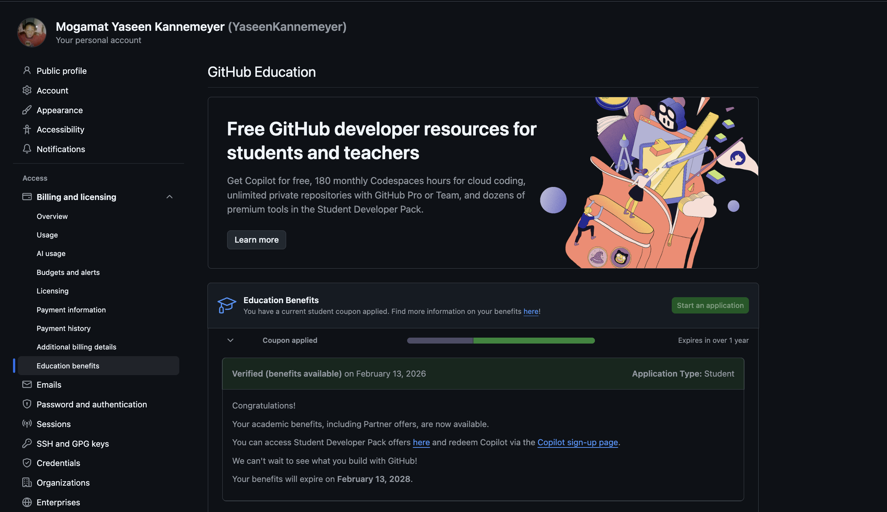

# Yaseen Kannemeyer
### Frontend Developer | Software Specialist

Cape Town, South Africa | [240453182@mycput.ac.za](mailto:240453182@mycput.ac.za) | 083-926-3595  
[GitHub Profile](https://github.com/YaseenKannemeyer) | [Digital Portfolio Website](https://yaseenkannemeyer.github.io/) | [Download my CV (PDF)](Mogamat_Yaseen_Kannemeyer_Student_CV.pdf) | [Agile Portfolio of Evidence](agile-portfolio.md)

---

### Table of Contents
* [About Me](#about-me)
* [GitHub Student Account](#github-account)
* [Curriculum Vitae](#cv)
  * [Professional Summary](#summary)
  * [Technical Skills](#skills)
  * [Education](#education)
  * [Work Experience](#experience)
  * [Projects](#projects)
  * [References](#references)
* [Mock Interview Video](#video)
* [Reflections (STAR Method)](#reflections)
  * [Reflection: Coding in Markdown](#ref-markdown)
  * [Reflection: Mock Interview Experience](#ref-interview)
  * [Reflection: GitHub Pages Deployment](#ref-ghpages)
* [Agile Portfolio of Evidence](#agile)
* [Career Goals](#goals)

---

## About Me

I am an Information Technology student studying for a **Diploma in Application Development** at the Cape Peninsula University of Technology (CPUT). I enjoy building responsive, interactive web applications and learning new software development tools.

I am most interested in frontend development, backend systems and databases, and in building applications that solve real problems for the people who use them. Since 4 August 2026 I have been an intern developer at Onsightapp, where I fix bugs and build features on the company's web consoles while I grow into a full-stack developer.

---

## GitHub Student Account

I created my GitHub account, [YaseenKannemeyer](https://github.com/YaseenKannemeyer), with my CPUT student email address. Through CPUT's partnership with GitHub Education, my account was verified for GitHub Education student benefits on 13 February 2026. This gives me the GitHub Student Developer Pack, which includes free access to developer tools.

*Evidence: my GitHub Education student benefits, verified on 13 February 2026.*

---

## Curriculum Vitae

[Download my CV (PDF)](Mogamat_Yaseen_Kannemeyer_Student_CV.pdf)

### Professional Summary
Frontend-focused IT student completing a Diploma in Application Development. Skilled in React, Vue and TailwindCSS, with experience building responsive, interactive UI components. Knowledgeable in backend development and databases (Java, Supabase). Experienced in small projects, debugging across multiple environments and component-based architecture.

### Technical Skills

| Category | Technologies |
| :--- | :--- |
| Languages | Java, C#, SQL, HTML, CSS, JavaScript, TypeScript |
| Frontend | React, Vue, Quasar, Next.js, TailwindCSS, Shadcn/ui |
| Backend | Java, .NET (C#), Node.js, PHP, Laravel |
| Databases | PostgreSQL, Supabase, MySQL |
| Testing | Playwright (end-to-end testing) |
| Tools & Hosting | Git, GitHub, Jira, Confluence, Claude Code, VS Code, IntelliJ IDEA, NPM, Vercel |
| Design | Figma, Canva |

### Education

#### Cape Peninsula University of Technology (CPUT), District Six
*Diploma in Application Development* | 2024 – Present

#### False Bay TVET College, Fish Hoek
*NCV Level 4: Information Technology and Computer Science* | 2020 – 2022

### Work Experience

#### Onsightapp
*Intern Developer (Work-Integrated Learning)* | August 2026 – Present
* Fix bugs on the company's new web console and its legacy web console and API, built with Quasar, Vue and .NET (C#).
* Deliver customer-specific features, such as minimum order quantity (MOQ) settings for documents.
* Write end-to-end tests with Playwright.
* Work in a Kanban team that plans and tracks work in Jira, with finished work grouped into regular releases.

#### Clicks, Garden Centre, Cape Town
*Retail Assistant (Christmas Flexi, Health & Pharmacy Section)* | November 2024 – January 2025
* Provided front-line customer service and retail support in the Health & Pharmacy section during the festive season.
* Helped customers with product enquiries and purchases.
* Worked as part of a busy team during peak trading.

#### Violet Poppy Trading, Epping, Cape Town
*Warehouse Assistant* | December 2022 – January 2024
* Processed and packaged garments at a finishing and packaging facility for retail clients such as Truworths, Identity and Foschini.
* Assisted with stock management and quality control.
* Worked under pressure to meet production deadlines.

### Projects

* **Mlangeni Grand Hospitality Catering Website** (2026, ongoing): a catering services website I am developing as part of a third-year university team project.
* **Nike ACG Web Application** (2026): a web application for Nike's ACG (All Conditions Gear) sub-brand, built with React and Tailwind CSS.
* **Campus Companion** (2025): a Java Swing desktop application that helps students with campus-related tasks and information.
* **AfriHack Connect Student Portal** (2025): a student portal I built with a team during the AfriHack Connect Hackathon.

More of my projects are on my [GitHub profile](https://github.com/YaseenKannemeyer).

### References

* **Amiena Toefy**, Store Manager, Clicks Garden Centre: +27 76 860 9657
* **Nabuweya Hector**, Warehouse Manager, Violet Poppy Trading: +27 82 851 3174

---

## Mock Interview Video

This is the recording of my mock interview from the work readiness programme.

  <iframe 
    src="https://drive.google.com/file/d/1IRIvBmRyJPONemBd5cYV8hGGGRmufpUM/preview" 
    width="640" 
    height="360" 
    allow="autoplay">
  </iframe>

If the video does not load, you can [download it from this repository](video/Mock%20Interview%20Video.mp4).

---

## Reflections (STAR Method)

### Reflection: Coding in Markdown
> **Situation:** For the Project Presentation 3 assessment, I had to build a digital portfolio on GitHub, written in Markdown, that includes my CV and my mock interview video.
>
> **Task:** I needed to learn GitHub Flavoured Markdown well enough to present my CV, evidence and reflections in a clear structure that is easy to navigate.
>
> **Action:** I learned the Markdown syntax for headings, lists, links, tables and embedded content. My first versions relied on HTML tags such as `<h2>` for headings, and I later rewrote them as Markdown headings, which are shorter and easier to maintain. I used a Markdown table for my technical skills and a table of contents with anchor links, so each section can be reached in one click. Where Markdown could not do what I needed, such as centring the video, I used HTML inside the Markdown file. I checked the result on GitHub after each change, and my commit history shows how the page developed step by step.
>
> **Result:** My CV and portfolio are written in Markdown and published online. I can now write README files and documentation in Markdown with confidence, which developers use every day in issues, pull requests and project documentation.

### Reflection: Mock Interview Experience
> **Situation:** As part of the work readiness programme, I took part in a mock interview that simulated a job interview for a software development role.
>
> **Task:** I had to explain my technical skills clearly, answer the interview questions well and present myself professionally.
>
> **Action:** I prepared by going through common behavioural and technical interview questions and practising my answers using the STAR method. During the interview I presented myself as I would in a real interview.
>
> **Result:** The mock interview made me more confident speaking about my skills and showed me which areas I need to work on before real interviews. The experience will help me when I apply for software development roles.

### Reflection: GitHub Pages Deployment
> **Situation:** The portfolio had to be published online with GitHub Pages so that it could be submitted as a link.
>
> **Task:** I had to deploy my repository as a website and make sure the CV, the video and all links worked on the live site.
>
> **Action:** I named my repository `YaseenKannemeyer.github.io`, which GitHub Pages publishes as my personal site at yaseenkannemeyer.github.io. The video was the hardest part. My first attempt used an HTML `<video>` tag, but the video did not play: the path pointed to a `videos` folder while the file was saved in `video`, and at 93 MB the file is close to GitHub's 100 MB file limit. I uploaded the video to Google Drive instead, embedded it with an `<iframe>` and centred it with a flex container. I then tested the links, the CV download and the video on the live site.
>
> **Result:** My portfolio is live at [yaseenkannemeyer.github.io](https://yaseenkannemeyer.github.io/). I learned how GitHub Pages turns a Markdown file into a website, why large media files are better hosted elsewhere, and how a small mistake in a file path can break a feature on a live page.

---

## Agile Portfolio of Evidence

My second portfolio covers the Agile practices I have taken part in during my internship at Onsightapp: the team charter, user stories and tasks, the product backlog, the sprint backlog (Kanban equivalent) and my Agile logbook. Each section includes evidence from our Jira boards and a reflection.

**[View my Agile Portfolio of Evidence](agile-portfolio.md)**

---

## Career Goals

I want to become a software developer specialising in frontend engineering and full-stack web development. I plan to keep improving my technical skills and to build clean, well-tested applications that are useful to the people and businesses who rely on them.

---

### Thank You
Thank you for taking the time to review my digital portfolio.
