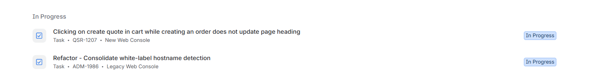
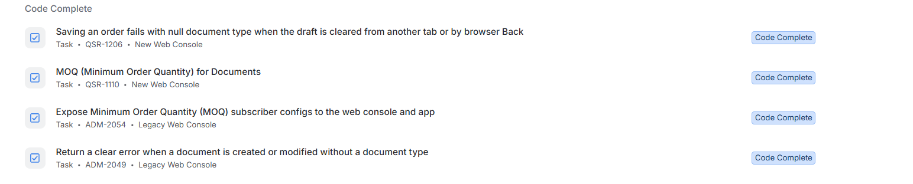
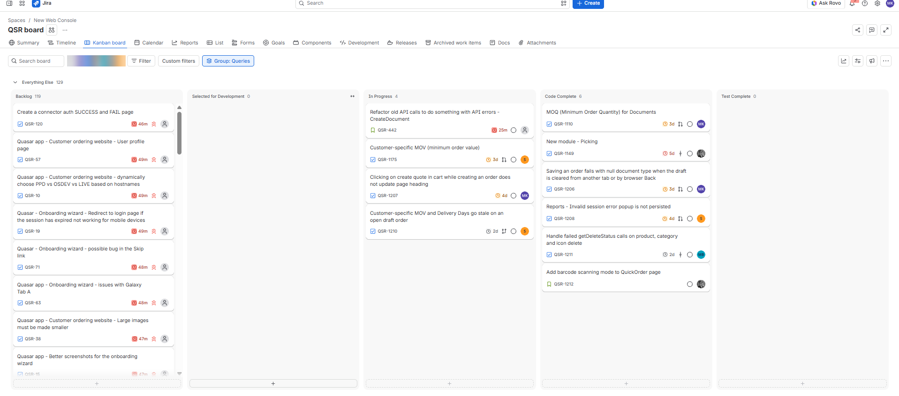
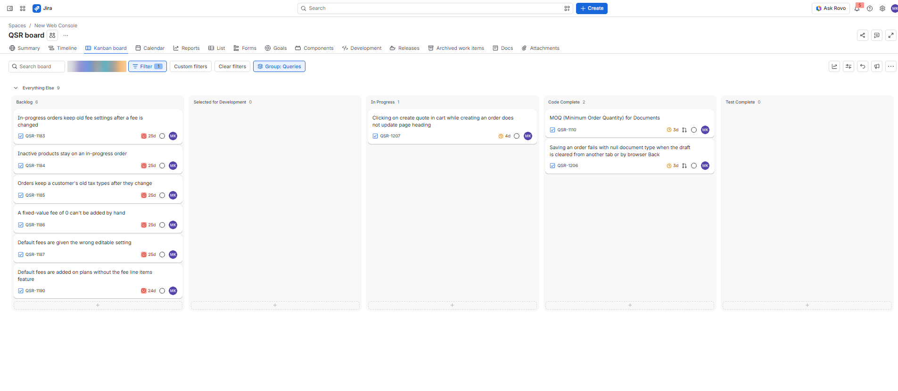
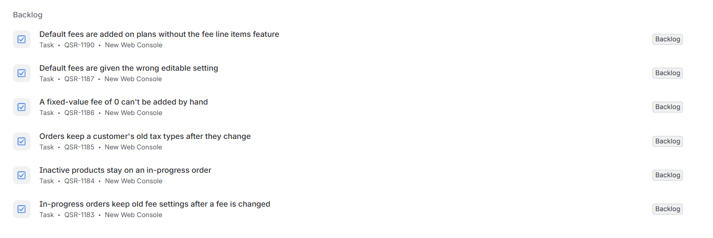
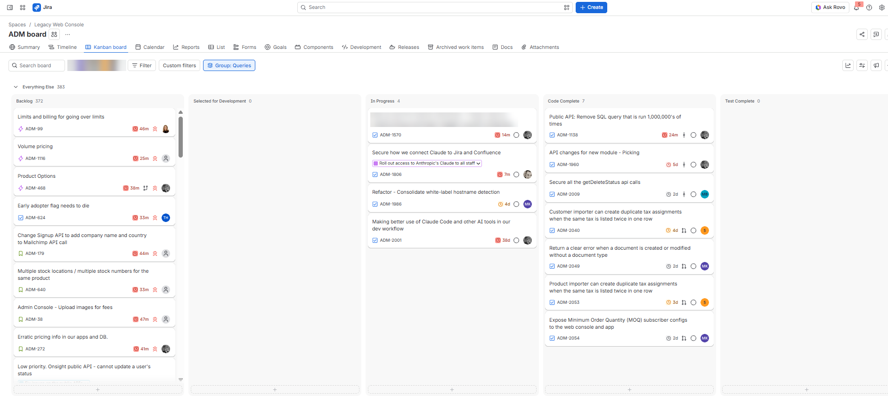
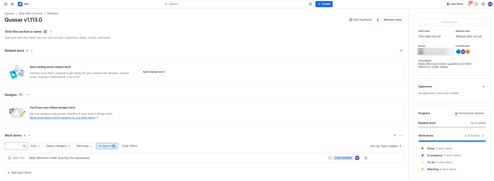
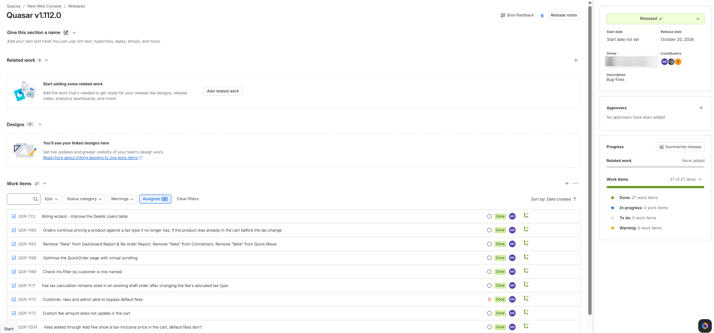
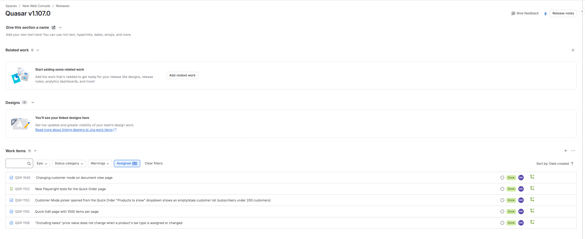
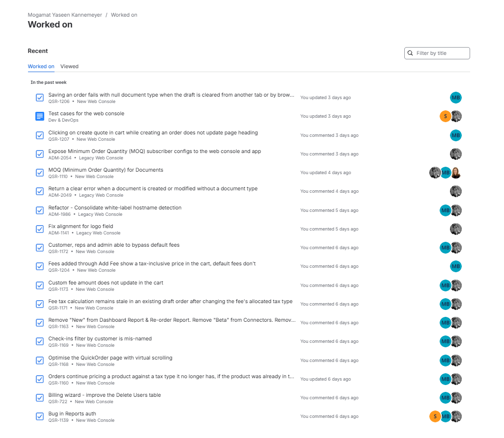

# Agile Portfolio of Evidence
### Workplace evidence and reflections from my software development internship at Onsightapp

**Name:** Mogamat Yaseen Kannemeyer  
**Qualification:** Diploma in Information and Communication Technology  
**Module:** Project Presentation 3 (2026\_0\_FT\_PRP372S)  
**Company:** Onsightapp  
**Date:** 26 October 2026

[Back to my main portfolio](https://yaseenkannemeyer.github.io/)

---

### Table of Contents
* [Introduction](#introduction)
* [1. Agile Team Charter](#charter)
* [2. User Stories and Tasks](#user-stories)
* [3. Product Backlog](#product-backlog)
* [4. Sprint Backlog (Kanban Equivalent)](#sprint-backlog)
* [5. Agile Logbook](#logbook)
* [6. Conclusion: Connecting the Evidence](#conclusion)
* [References](#references)

---

## Introduction

This portfolio brings together evidence of the Agile practices I have taken part in since starting my work-integrated learning (WIL) internship as an intern developer at Onsightapp on 4 August 2026. I work in a development team that maintains two related products: a new web console and a legacy web console with its API. We work with Quasar and Vue on the front end and .NET (C#) on the back end. The team plans and tracks all work in Jira, documents shared knowledge in Confluence and talks day to day on Slack.

My main role is fixing bugs on both consoles. More recently I have also been given customer-specific tasks. During the internship I learned Playwright for end-to-end testing and how to use MCPs (Model Context Protocol servers) to connect Claude to other tools. The team uses Claude Code heavily in its daily development work. I have learned to get the best out of it, while the team as a whole is still learning how to use it well.

My team does not run full Scrum. We work in Kanban, a method that makes work visible on a board and limits how much is in progress at once (Anderson, 2010). There are no fixed sprints, and work moves across a board with the columns Backlog, Selected for Development, In Progress, Code Complete, Test Complete and Done. Finished work is grouped into numbered releases, and each release acts as our delivery timebox. Where this portfolio asks for Scrum artefacts such as a sprint backlog, I show the Kanban equivalent and explain the difference in the reflection.

The brief describes Trello as a Kanban tool. My team uses Jira instead, which works the same way: cards (tickets) move across columns on a visual board. The Jira boards in this portfolio are the equivalent of a Trello board.

I built this portfolio using the four e-portfolio steps in the brief: collect, select, reflect and connect (CPUT, 2026). I collected screenshots from our Jira boards, releases and my work history, along with my notes on stand-ups and releases. From these I selected the artefacts that best show each of the five Agile practices in the rubric, using real tickets I worked on so that every claim can be checked against the evidence. Each section shows the evidence first, followed by a reflection on what I learned, and the conclusion connects the five sections.

*Names of colleagues and clients have been blurred in the screenshots. Click any screenshot to open it at full size.*

---

## 1. Agile Team Charter

### Evidence

My team does not have a formal written charter. I drafted the charter below from how the team actually works day to day, based on what I have observed in stand-ups, code reviews, the Jira workflow and the team’s weekly routines.

| Area | Agreement |
| :--- | :--- |
| **Purpose** | Deliver and maintain the web console and API used by our subscribers, shipping bug fixes and features in small, regular releases. |
| **Values** | Transparency: if work is happening, it is on the board. Quality: every change is reviewed and tested before it is released. Ownership: the person assigned to a ticket sees it through to Code Complete. Helping each other: asking for help early is better than staying stuck. Learning together: knowledge is shared openly, through code reviews and the weekly dev share. Responsible use of AI: Claude Code speeds up the work, but the developer still reads, tests and takes responsibility for every change before it goes to review. |
| **Roles** | Release driver / lead developer: plans releases and prioritises the backlog. Developers: build, review and fix tickets on both consoles. Testers: test Code Complete tickets and move them to Test Complete. Mentor: supports interns with onboarding, reviews and blockers. Me, intern developer: mainly fix bugs on both consoles, take on customer-specific tasks, and write Playwright tests. |
| **Meetings** | Daily stand-up. End-of-week check-in on Fridays. Release planning when the next release is created. Dev share every Wednesday, where team members share knowledge (the topic does not have to be work-related). Fun Friday every Friday, where the team plays games together. |
| **Working agreements** | Every piece of work has a Jira ticket, including small fixes. Each person keeps only one or two tickets In Progress at a time. Each code branch is linked to its Jira ticket. Ticket-specific discussion happens in Jira comments, so the history stays with the ticket. |
| **Code review** | All changes go through a pull request. At least one approval is needed before merging, review feedback is applied before merging, and nobody pushes directly to the main branch. |
| **Definition of Done** | Code reviewed, approved and merged. Tested in the test environment and moved to Test Complete. Automated tests added or updated where relevant. Included in a release, and the release is marked Released. |
| **Raising blockers** | Mention the blocker at stand-up. If it is stopping work completely, raise it straight away on Slack or with my mentor, without waiting for the next day. |
| **Communication** | Slack for day-to-day questions, Jira comments for ticket discussion, Confluence for documentation (e.g. the shared test-cases page). |
| **Boundaries** | Don’t move or reassign someone else’s ticket without asking. Client and commercial data stays inside company tools. |

### Reflection

A team charter is the set of agreements about how a team works together: how we communicate, how work flows, who does what and what “done” means. The brief describes it as a “living, co-created social contract” (CPUT, 2026). My team has never written one down, so I drafted this charter myself by observing how the team works in stand-ups, code reviews, the Jira workflow and our weekly routines. It reflects how the team operates in practice and has not been formally agreed by the team. My role in it is that of a team member who follows these agreements and, as an intern, is still learning them.

Even without a written charter, the agreements clearly exist, and they matter because they keep a team with several developers and two products consistent. For example, every change goes through a pull request and is linked to its Jira ticket. Because of that, anyone can see who is working on what and why a change was made. This is especially important in our stack. We work with Quasar, Vue and .NET (C#), so one feature can touch both the front end and the API, and the ticket is where the two halves are tied together.

The clearest example of learning these unwritten rules was the Definition of Done. When I started, I assumed a ticket was finished once my code was merged. I then learned that our board separates Code Complete from Test Complete and Done. Several of my tickets, such as the minimum order quantity feature, are still in Code Complete because they have not yet been tested or released. That taught me that a ticket is only done once the team has tested and released it.

The agreements matter even more because the team uses Claude Code heavily. It lets us write and change code much faster, which also means a lot of code can reach a pull request very quickly. The review, testing and Definition of Done rules are what keep that speed safe. I included responsible use of AI as a value in my draft charter because the team is still working out how best to use Claude Code. In a written charter I would turn it into a clear working agreement, such as always reading and testing what Claude produces before opening a pull request.

A charter should also capture how the team treats each other. Every Wednesday we have a dev share, where anyone can share something they have learned, and it does not have to be work-related. Every Friday is Fun Friday, where the team plays games together. These routines have nothing to do with delivery, yet they build the trust behind the value of “helping each other”. As an intern it is far easier to ask a question or admit I am stuck when I know my colleagues as more than names on tickets and code reviews. The dev share is also a chance to pick up knowledge that would never appear on a Jira ticket.

If I did this again, I would ask my mentor or the release driver early on whether a charter existed. If none did, I would suggest writing a short one in Confluence that also covers how the team uses Claude Code. New interns would then learn the agreements on day one instead of picking them up over several weeks. I would also ask my mentor to review it, so that the whole team agrees to it and it stops being only my own observation.

---

## 2. User Stories and Tasks

### Evidence

Our Jira tickets are written as tasks and bug titles, not in the formal “As a user…” format. The table below recreates some of my real tickets as user stories, with acceptance criteria and the tasks I broke them into. Figures 1 and 2 show the same tickets in Jira.

| User story | Acceptance criteria | Tasks and status |
| :--- | :--- | :--- |
| As a rep creating an order, I want the order to save even if the draft was cleared in another tab or with the browser Back button, so that I don’t lose my order or see an error. | Saving never sends an empty document type. The user sees a clear message if the draft no longer exists. No unhandled error is shown. | Reproduce with two tabs and with Back. Guard against a missing document type before saving. Test both paths. **Status:** Code Complete |
| As a developer using the API, I want a clear error when a document is created or changed without a document type, so that problems are explained instead of failing silently. | The API rejects the request with a clear, readable message. Valid requests are unaffected. | Add validation on create and on modify. Return a meaningful error message. **Status:** Code Complete |
| As a subscriber, I want to set a minimum order quantity (MOQ) for my products, so that customers can’t order less than I can supply. | MOQ settings are available to the web console and the app. Documents below the MOQ are stopped with a clear message. | Expose the MOQ settings through the legacy API. Enforce the MOQ on documents in the new console. **Status:** Code Complete, planned for the next release |
| As a user in the cart, I want the page heading to change when I click Create Quote, so that I always know which document I’m creating. | The heading switches to the quote heading as soon as Create Quote is clicked. | Find where the heading is set. Update it when the document type changes. **Status:** In Progress |
| As a subscriber, I want default fees to always be applied, so that customers, reps and admins cannot bypass them. | Default fees cannot be removed by any role. Fees show correctly in the cart. | Fix the bypass for each role. Check how fees display in the cart. **Status:** Done (released) |

*Figure 1: My two tickets currently In Progress, one on each product*

*Figure 2: My tickets in Code Complete across both products, waiting for testing and release*

### Reflection

User stories describe what a user needs and why (Cohn, 2004). Tasks are the smaller technical steps needed to deliver a story. In my team, Jira tickets are usually written as short task or bug titles, such as “Saving an order fails with null document type…”, rather than in the “As a… I want… so that…” format. My main role is fixing bugs on both consoles, and recently I have also been given customer-specific tasks. In both cases my job is to pick up a ticket, work out what the user actually needs, and break the work into steps I can complete and test.

Clear stories matter because they give developers, testers and the release driver the same understanding of what “working” looks like. Without it, a tester cannot tell whether a fix is complete. It also matters for the automated tests I write in Playwright: a good acceptance criterion such as “the user sees a clear message if the draft no longer exists” translates almost directly into a test, whereas a vague ticket title does not.

A specific example is the order-saving bug. The ticket title described the symptom, but I first had to reproduce it: open the same draft in two tabs, clear it in one, then save in the other. Writing those exact steps showed me the problem had two parts. The new console needed to handle a missing draft gracefully, and the API needed to return a clear error instead of failing quietly. I split this into two tickets, one for each product. That taught me that breaking a story down well often means splitting it across front end and back end. The same two-tab and Back-button steps then became my test plan for the fix.

Customer-specific tasks have been a different kind of work from bug fixing. A bug already has a clear “before” and “after”, but a customer-specific task, such as the minimum order quantity and value work, starts from what a particular customer needs. That makes the story and its acceptance criteria much more important. I have learned to ask more questions up front: who uses this, what should happen when they hit the limit, and does it affect other customers? It is better to find those gaps before coding than during testing, and it is the closest I get in my daily work to writing a real user story.

I also use Claude Code when I break a ticket into tasks and work through them. It gives much better results when I give it a clear description, the acceptance criteria and the steps to reproduce, which is another reason to write the story properly before starting. Learning to work with Claude Code this way, and learning to use MCPs to connect it to the tools I work with, has been one of the biggest skills I have gained so far.

In future I would write the acceptance criteria into the ticket before starting to code, even when the ticket is only a bug title. Rewriting my tickets as user stories for this portfolio showed me how much clearer they become, and how much easier they would be for a tester, or a Playwright test, to check.

---

## 3. Product Backlog

### Evidence

The product backlog is the Backlog column of our Kanban board. It holds all the work that has been identified but not yet started. Figure 3 shows the full team board, Figure 4 shows the backlog items assigned to me, and Figure 5 shows them as a list.

#### How the backlog is prioritised

The backlog is ordered from top to bottom, with the most important items at the top of the column. Several signals on each card help the team decide what to pull next. The red double-arrow icon marks a high-priority item (for example, the default-fees bypass bug was flagged this way and was fixed in the bug-fix release). The clock icon shows how long a card has been in its column, turning red as it ages. Items are moved into Selected for Development when they are picked for the next release, and the release driver confirms the order at release planning.

*Figure 3: The team board for the new web console, with 119 items in the backlog*

*Figure 4: The same board filtered to my tickets: six backlog items, one in progress and two in code complete*

*Figure 5: My backlog tickets in list view*

### Reflection

The product backlog is the ordered list of everything the team might work on: bugs, improvements and new features. The Scrum Guide calls it “an emergent, ordered list of what is needed to improve the product” (Schwaber & Sutherland, 2020). In my team it is the Backlog column of the Jira board. The new web console currently has 119 items in its backlog, and items move to Selected for Development when they are picked for upcoming work. My role is to add tickets when I find problems, and to pick up the backlog work assigned to me. I mainly fix bugs, so most of what I pull from the backlog is bug work, but now that I am also getting customer-specific tasks I can see how the same backlog has to hold both small fixes and requested features.

The backlog matters because it stops ideas and bugs from getting lost and gives the team one place to decide priorities. It also protects the work in progress: when a new problem is logged instead of being fixed on the spot, the current ticket stays focused. The release driver then has something concrete to prioritise at release planning and does not have to rely on people’s memory.

My best example is the six tickets in my backlog, five of which are about fees and taxes. While fixing fee bugs for a bug-fix release, I noticed related edge cases. For example, in-progress orders keep old fee settings after a fee changes, and a fixed fee of 0 can’t be added by hand. Instead of widening my current tickets, I logged each one as its own backlog item so it could be prioritised separately. This helped keep that release on track, and every one of my tickets in it was finished.

Prioritising is harder than it looks. A bug that is small for the team can be urgent for a customer, which is why the high-priority flag and the release driver’s judgement matter more than the order of the column alone. Working on customer-specific tasks has made me more aware that “most important” depends on who is asking, and that someone has to weigh those requests against each other.

What I would do differently: these items have now been in the backlog for about 25 days, and the board flags them as ageing. Next time I would add a short description, steps to reproduce and a suggested priority when creating each ticket. I would also raise them at release planning, so the team can decide quickly whether they belong in the next release.

---

## 4. Sprint Backlog (Kanban Equivalent)

### Evidence

My team works in Kanban and has no sprints. The closest equivalent to a sprint backlog is the work currently on the board (Selected for Development, In Progress and Code Complete) together with the release it is planned for. Each release has a goal in its description, a set of work items and a progress bar.

*Figure 6: Board for the legacy console and API: the In Progress and Code Complete columns show the team’s current work*

*Figure 7: The upcoming release with the goal “MOQ and MOV”: 0 of 4 items done, my MOQ ticket in Code Complete*

*Figure 8: A completed bug-fix release: 27 of 27 items done; the filter shows the nine items I delivered*

*Figure 9: An earlier release with five of my items done, including Playwright tests for the Quick Order page*

### Reflection

In Scrum, the sprint backlog is made up of the sprint goal, the product backlog items selected for the sprint and a plan for delivering them (Schwaber & Sutherland, 2020). My team does not use sprints. We use Kanban, so work flows continuously across the board and is grouped into releases. Each release has a short goal in its description, such as “Bug-fixes” or “MOQ and MOV”, which works like a sprint goal. Its progress panel shows how many items are done, in progress or still to do. My role is to deliver the tickets assigned to me in each release.

This view matters because it shows what the team is focused on right now and whether a release is ready to ship. For the bug-fix release I contributed nine of the 27 items, all of which were completed before the release date.

One thing I learned from the board is how Kanban exposes bottlenecks. Both boards currently have several tickets in Code Complete and none in Test Complete, so work is piling up while it waits for testing. Two of my own tickets are sitting there. I suspect that tools like Claude Code are part of the reason: they help us write code faster, so more tickets reach Code Complete, but the amount of testing the team can do has not grown at the same speed. Since I write Playwright tests and helped with the team’s test-cases page in Confluence, I could help clear that queue before starting new work, which Kanban teams often sum up as “stop starting, start finishing”.

Releases also suit customer-specific work well. A customer’s need can be given a release goal such as “MOQ and MOV” and a short list of items, and the progress bar shows whether the delivery is realistic. The risk is the dependency I noted in my logbook: the front-end MOQ ticket and the API ticket that exposes the settings must be released together, so a delay in one holds back the other.

What I would do differently: I would watch the Code Complete column more closely and offer to help with testing when it grows. I would also suggest agreeing a work-in-progress limit for Code Complete (Anderson, 2010), so the team notices the queue before it delays a release.

---

## 5. Agile Logbook

### Evidence

This logbook records daily stand-ups using the three stand-up questions, plus release planning and retrospective notes. Because my team works in Kanban, release planning takes the place of sprint planning. It covers my first week (4–7 August) and a recent week (20–23 October), so it shows how my work has grown over the internship.

#### Week 1: 4–7 August 2026

**Tuesday 4 August 2026**

| Stand-up question | Answer |
| :--- | :--- |
| What did I complete since the last stand-up? | First day of my internship. Completed onboarding, met my mentor and the development team, and received my email, Slack and repository access. Cloned the repository and set up my development environment. |
| What am I planning to complete before the next stand-up? | Get the application running locally and learn how the team tests it. |
| What are my impediments (risks or problems)? | Still waiting on access to the test environment. |

**Wednesday 5 August 2026**

| Stand-up question | Answer |
| :--- | :--- |
| What did I complete since the last stand-up? | Got the application running locally. Was introduced to Playwright, the end-to-end testing tool the team uses. Worked through the documentation and ran the example tests. |
| What am I planning to complete before the next stand-up? | Write my first Playwright tests for the login page. |
| What are my impediments (risks or problems)? | Needed test account details for the test environment. My mentor sorted this out. |

**Thursday 6 August 2026**

| Stand-up question | Answer |
| :--- | :--- |
| What did I complete since the last stand-up? | Wrote my first Playwright tests for the login flow: a valid login, a wrong password and empty required fields. Learned how locators and assertions work. |
| What am I planning to complete before the next stand-up? | Open a pull request for the tests and ask for a review. |
| What are my impediments (risks or problems)? | One test was flaky because of timing. Fixed it by using Playwright’s built-in waiting (expect) instead of a fixed timeout. |

**Friday 7 August 2026**

| Stand-up question | Answer |
| :--- | :--- |
| What did I complete since the last stand-up? | Opened my first pull request. Received review feedback to use role-based locators and the Page Object Model, and started refactoring. Attended the team stand-up and the end-of-week check-in. |
| What am I planning to complete before the next stand-up? | Finish the refactor, get the pull request merged, and start testing navigation and core forms next week. |
| What are my impediments (risks or problems)? | None. Still getting used to the size of the codebase. |

#### Week 1 walkthrough

| Question | Answer |
| :--- | :--- |
| What do we need to do to advance this work? | Get my login-test pull request approved and merged, then start writing tests for the next user flows (navigation and core forms). |
| Is anyone working on anything not on the board? | Yes. I spent time reading through the codebase and documentation to understand the app. This was not tracked as a ticket. |
| What do we need to finish as a team? | Agree on one structure for the Playwright test suite (folders, naming, Page Object Model) so all tests follow the same pattern. |
| Are there any bottlenecks or blockers to the flow of work? | Waiting for test-environment login details slowed me down early in the week. Some tests were flaky because of timing. |

#### Week 12: 20–23 October 2026

**Tuesday 20 October 2026**

| Stand-up question | Answer |
| :--- | :--- |
| What did I complete since the last stand-up? | The bug-fix release went out today with all 27 items done, including the nine I worked on (mostly fee and tax fixes in the cart). Went back through my tickets and added comments confirming what was fixed and how to test it. |
| What am I planning to complete before the next stand-up? | Pick up my next tickets on the legacy console: the white-label hostname refactor and a logo alignment fix. |
| What are my impediments (risks or problems)? | None. |

**Wednesday 21 October 2026**

| Stand-up question | Answer |
| :--- | :--- |
| What did I complete since the last stand-up? | Started the refactor to consolidate white-label hostname detection into one place on the legacy console. Commented on the logo alignment ticket with my findings. |
| What am I planning to complete before the next stand-up? | Move the minimum order quantity (MOQ) feature to Code Complete for the next release. |
| What are my impediments (risks or problems)? | The hostname logic is used in several places, so I need to be careful not to break existing customer sites. |

**Thursday 22 October 2026**

| Stand-up question | Answer |
| :--- | :--- |
| What did I complete since the last stand-up? | Finished the MOQ for documents feature in the new console and moved it to Code Complete. Followed up on my API ticket that returns a clear error when a document has no document type. |
| What am I planning to complete before the next stand-up? | Fix the bug where saving an order fails if the draft was cleared in another tab or with the browser Back button. |
| What are my impediments (risks or problems)? | The MOQ feature depends on the API ticket that exposes the MOQ settings, so both need to be tested together. |

**Friday 23 October 2026**

| Stand-up question | Answer |
| :--- | :--- |
| What did I complete since the last stand-up? | Fixed the order-saving bug and moved it to Code Complete. Updated the shared test-cases page in Confluence. Started on the bug where clicking Create Quote in the cart does not update the page heading. |
| What am I planning to complete before the next stand-up? | Finish the page heading bug and support testing of my Code Complete tickets. |
| What are my impediments (risks or problems)? | My tickets are queuing in Code Complete because no one has moved them to Test Complete yet. |

#### Release planning notes (Kanban equivalent of sprint planning)

| Item | Notes |
| :--- | :--- |
| **Release** | The next new web console release, planned after the bug-fix release shipped on 20 October. |
| **Release goal** | MOQ (Minimum Order Quantity) and MOV (Minimum Order Value). |
| **Work items** | Four items, including minimum order quantity for documents (mine) and customer-specific minimum order value. |
| **My commitment** | Deliver the MOQ for documents feature in the new console, supported by my API ticket that exposes the MOQ settings to the web console and app. |
| **Risks** | The front-end and API changes must be released together. Testing capacity is limited, so items may wait in Code Complete. |

#### Retrospective: bug-fix release (23 October 2026)

My team does not hold a formal retrospective after each release, so this is my personal retrospective on the bug-fix release that shipped on 20 October.

| Question | Notes |
| :--- | :--- |
| **What went well?** | All 27 items in the release were completed, including all nine of mine. Logging the fee and tax edge cases I found as new backlog tickets kept my existing tickets focused and on schedule. Writing testing notes in Jira comments made it easier for others to check my fixes. |
| **What didn’t go well?** | Six related edge cases, mostly with fees and taxes, were only found late, and they are now ageing in the backlog. Tickets wait in Code Complete because testing is a bottleneck. My logbook has a gap between August and October. |
| **What will I change?** | Write acceptance criteria and edge cases into a ticket before I start coding. Help with testing when Code Complete builds up, using the shared test-cases page and Playwright. Raise my ageing backlog tickets at the next release planning. Keep my logbook every day, even if only briefly. |

*Figure 10: My Jira “Worked on” history for 20–23 October, matching the log entries above*

### Reflection

An Agile logbook records daily stand-ups, sprint plans and retrospective notes (CPUT, 2026). My daily entries answer the three stand-up questions: what I completed, what I plan to do next and what is blocking me. My team’s stand-ups are spoken and not written down, so I wrote this log myself, using my notes and my Jira history to keep the entries accurate.

The logbook matters for two reasons. For the team, the stand-up questions make blockers visible early. On my second day, saying I was missing test-environment details meant my mentor fixed it the same morning instead of me losing a day. For me, writing it down shows how quickly I am progressing and gives me evidence to look back on.

A specific thing I learned in my first week was about flaky tests. One of my login tests sometimes passed and sometimes failed. I had used a fixed wait, which only works if the page loads in time. Replacing it with Playwright’s built-in expect, which waits until the condition is true, made the test reliable. The review feedback on my first pull request, to use role-based locators and the Page Object Model, also taught me that code review keeps the whole test suite consistent, which matters as much as whether my own test passes.

Since then I have also learned to use MCPs and to get much more out of Claude Code. That learning happened gradually and does not show up as a single ticket, which is one limit of a log built only around the three stand-up questions. The same is true of the Wednesday dev share and Fun Friday. They are not recorded in the tables above, but they are part of how the team stays connected, and writing this log made me realise that I should also note down what I pick up at the dev share.

Comparing the two weeks shows how much I have grown. In August I was writing my first login tests and learning how pull requests work. By October I was delivering features and bug fixes across both products, planning work around a release goal, and noticing team-level problems like the testing bottleneck.

What I would do differently: my log has a gap between August and October, even though I kept working on tickets, as my Jira history shows. I would keep the log going every day, even briefly, so it gives a complete record of my growth. I would also create a ticket for “untracked” work like learning the codebase, so it is visible on the board.

---

## 6. Conclusion: Connecting the Evidence

Looking at the five artefacts together, each one gives a different view of the same way of working. The team charter sets the rules, especially the Definition of Done. The user stories and tasks are where I apply those rules to individual pieces of work. The product backlog holds everything still waiting, the release view shows what the team is focused on now, and the logbook records what I actually did each day.

One thread runs through all of them: the fee and tax bugs. I fixed several of them as tasks (section 2). While doing so I found related edge cases and logged them in the backlog instead of growing my tickets (section 3). The fixes shipped as part of a completed release (section 4), and my retrospective identified those late-found edge cases as something to prevent next time by writing acceptance criteria first (section 5).

A second thread is the Definition of Done. Writing the charter made me realise that “done” means tested and released, not just merged (section 1). The release and board views then showed my tickets queuing in Code Complete (section 4), and my logbook and retrospective turned that into an action: help with testing instead of starting new work (section 5).

Across the internship, my growth shows in the logbook. In my first week I was learning Playwright and responding to my first code review. By October I was owning features across two products, taking on customer-specific tasks, and thinking about how work flows through the whole team. The biggest lesson I take from this portfolio is that Agile depends on making work visible, so problems can be found and fixed early.

Going forward, I will take three things into my next role or project. First, I will keep all work visible on the board, including the small things. Second, I will write acceptance criteria before I start coding. Third, I will use tools like Claude Code and Playwright to deliver good work faster while still putting every change through review and testing. I would also like to keep sharing what I learn about these tools with the team at the dev share.

---

## References

Anderson, D.J. 2010. *Kanban: successful evolutionary change for your technology business*. Sequim, WA: Blue Hole Press.

Cohn, M. 2004. *User stories applied: for agile software development*. Boston: Addison-Wesley.

CPUT (Cape Peninsula University of Technology). 2026. *Project Presentation 3 (PRP370S, PRP371S, PRP372S): Assessment 2, October 2026*. Unpublished assessment brief. Cape Town: Faculty of Informatics and Design.

Schwaber, K. & Sutherland, J. 2020. *The Scrum Guide: the definitive guide to Scrum: the rules of the game*. [https://scrumguides.org/scrum-guide.html](https://scrumguides.org/scrum-guide.html) [26 October 2026].

---

[Back to my main portfolio](https://yaseenkannemeyer.github.io/)
